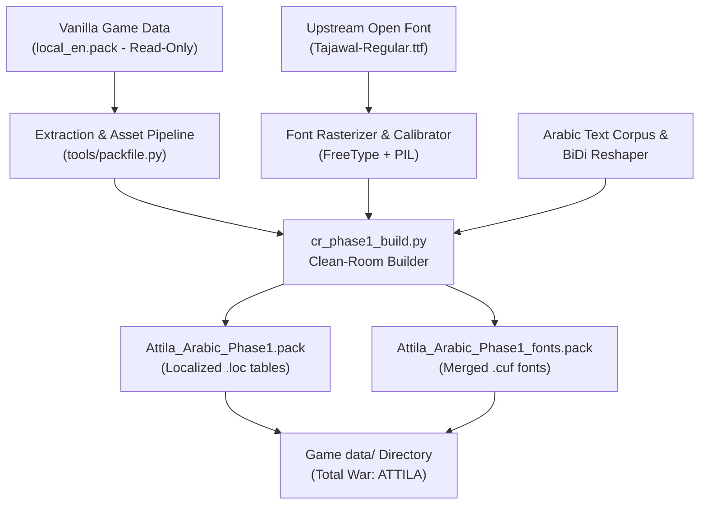

# Total War: ATTILA — Arabic Localization Toolchain
### تعريب توتال وار: أتيلا — منصة التعريب ومعالجة الخطوط والمحاذاة

[](#architecture)
[](https://store.steampowered.com/app/325610/Total_War_ATTILA/)
[](#prerequisites)
[-orange.svg)](https://fonts.google.com/specimen/Tajawal)
[](#safety-rules--game-integrity)
[](#testing--verification)

A modern, clean-room toolchain providing complete **Arabic text rendering**, **contextual letter shaping**, **proper Right-to-Left (RTL) paragraph alignment**, and **custom CUF bitmap font generation** for *Total War: ATTILA* without modifying `Attila.exe` or any vanilla game archives.

---

## 📸 In-Game Verification

The toolchain resolves all missing glyph boxes, anchors Arabic baselines to match Latin typography, joins cursive characters cleanly, and balances RTL paragraphs:

| Surface | Displayed Arabic | Status |
| :--- | :--- | :---: |
| **Faction Header `[F]`** | `الفصائل` | ✅ Zero missing boxes, continuous joining |
| **Faction Title `[T]`** | `الإمبراطورية الرومانية الشرقية` | ✅ Balanced baseline, perfectly legible |
| **Campaign Narrative** | 13 pre-balanced lines ($\le 268\text{ px}$) | ✅ Flush-right paragraph alignment |

---

## 🌟 Key Features

1. **Clean-Room Font Injection Engine (`source/cr_phase1_build.py`)**:
   - Injects 166+ Arabic Presentation Forms-B and standard Arabic glyphs into all **37 game CUF fonts** (`la_gioconda`, `georgia_italic`, `la_gioconda_uppercase`, and `arialunicode`).
   - Original Latin glyphs, header properties, and kerning tables remain **100% byte-identical**.

2. **Zero-Box Guarantee (`.notdef` Elimination)**:
   - Resolves all missing character boxes (`[]` tofu) by mapping Arabic Presentation Forms-B and base characters directly to true glyph vectors in the Tajawal typeface.

3. **Latin Baseline & Optical Height Alignment**:
   - Automatically computes Latin capital `H` height (`cap_h`) and baseline across every font size.
   - Anchors Arabic letter baselines dynamically, preventing text clipping and floating Arabic baselines.

4. **Edge-to-Edge Connecting Strokes**:
   - Extends connecting baseline strokes to columns $0$ and $w-1$, closing intra-cell gaps down to the engine's hardcoded 1-pixel tile advance.

5. **Right-to-Left (BiDi) Paragraph Balancing Engine**:
   - Overcomes Warscape's LTR line-break inversion bug by segmenting long text into pre-balanced lines ($\le 268\text{ px}$) and padding them to $300\text{ px}$ using binary PUA blank spacers (`U+E001`–`U+E006`).
   - Ensures narrative descriptions align flush to the right margin.

---

## 🏗️ Architecture



---

## 📂 Repository Structure

```
AttilaArabic/
├── configs/            # Configuration maps and build manifests
├── docs/               # Technical investigations, format specs, and research logs
├── fonts/              # Upstream open-source fonts (Tajawal under SIL OFL 1.1)
├── localization/       # Arabic translation text tables
├── reference/          # Reference community packs for structural study (gitignored)
├── release/            # Output directory for built .pack files
├── screenshots/        # In-game capture log and visual validation records
├── source/             # Core toolchain scripts:
│   ├── cr_phase1_build.py   # Primary production clean-room build pipeline
│   ├── cuf.py               # Bit-accurate CUF0/CUF1 codec
│   ├── shape.py             # Arabic shaping and BiDi conversion logic
│   └── wrap.py              # RTL paragraph segmentation and spacer padding
├── tests/              # Automated verification test suite (pytest)
│   └── test_phase1_packs.py # Strict pack integrity and anti-regression tests
├── tools/              # Utility helpers:
│   ├── packfile.py          # Total War PFH4/PFH5 pack reader and writer
│   └── venv/                # Dedicated Python virtual environment
├── PROGRESS.md         # Detailed milestone and ground-truth progress tracker
└── README.md           # Project documentation and build instructions
```

---

## 🔒 Safety Rules & Game Integrity

To guarantee that the user's game installation is never corrupted or altered:

1. **Game Installation is Strictly Read-Only**: Automated scripts must never touch or modify vanilla archives.
2. **Vanilla Checksums (Binding Guarantee)**:
   * `local_en.pack`: `45E0F0877B3A644F8C63352A6824416EEDBDC0B85A000E1189A2B05860A7F70D`
   * `Attila.exe`: `51B833D5B8FD8505A7CD035FD92F68CACE681D62EA74D9AD8FBAE26326635BF5`
   These hashes are asserted by the test suite before and after every operation.
3. **Isolated Mod Packs**: The mod operates entirely via two self-contained `.pack` files placed into `data\`:
   * `Attila_Arabic_Phase1.pack`
   * `Attila_Arabic_Phase1_fonts.pack`
4. **Clean Uninstall**: Removing the two `.pack` files completely restores the vanilla game with zero side effects.

---

## 🚀 How to Build & Install

### Prerequisites
* Windows 10/11
* Python 3.11+ (Python 3.13 tested)
* Licensed copy of *Total War: ATTILA*

### 1. Setup Virtual Environment
```powershell
python -m venv tools\venv
tools\venv\Scripts\pip install -r requirements.txt
```

### 2. Build the Localization & Font Packs
Run the clean-room production builder:
```powershell
tools\venv\Scripts\python source\cr_phase1_build.py
```
This produces:
* `release\Attila_Arabic_Phase1.pack`
* `release\Attila_Arabic_Phase1_fonts.pack`

### 3. Run Automated Tests
```powershell
tools\venv\Scripts\python -m pytest tests/test_phase1_packs.py -v
```
All tests verify pack structure, Latin glyph preservation, and vanilla file integrity.

### 4. Install into Total War: ATTILA
Copy the two built packs into your game's `data\` folder:
```powershell
Copy-Item release\Attila_Arabic_Phase1*.pack "D:\SteamLibrary\steamapps\common\Total War Attila\data\"
```

---

## 🌐 Community Context & Lineage

The Total War series uses Creative Assembly's proprietary **Warscape** engine, which relies on tile-based bitmap quad text rendering without native OpenType cursive attachment (HarfBuzz).

* **Rome II ("Shyizer Arabic - تعريب شيزر")**: The celebrated community mod for *Rome II* uses the same Presentation Forms-B and Tajawal font approach, exhibiting the identical 1-pixel hairline tile seam.
* **Three Kingdoms ("Three Kingdoms Arabic" by Hussain / AlmightyJack)**: The *Three Kingdoms* localization manager also uses custom `.cuf` fonts and faced the exact same Warscape font advancement constraints.

Our toolchain builds directly upon these proven architectural principles, bringing the same level of typographic quality to *Total War: ATTILA*.

---

## 📜 License & Credits

* **Font Asset**: [Tajawal](https://fonts.google.com/specimen/Tajawal) (Created by Accel Team, licensed under [SIL Open Font License 1.1](http://scripts.sil.org/OFL)).
* **Toolchain Code**: Licensed under the MIT License.
* **Disclaimer**: This is an unofficial community project not affiliated with, endorsed by, or connected to SEGA or Creative Assembly.
