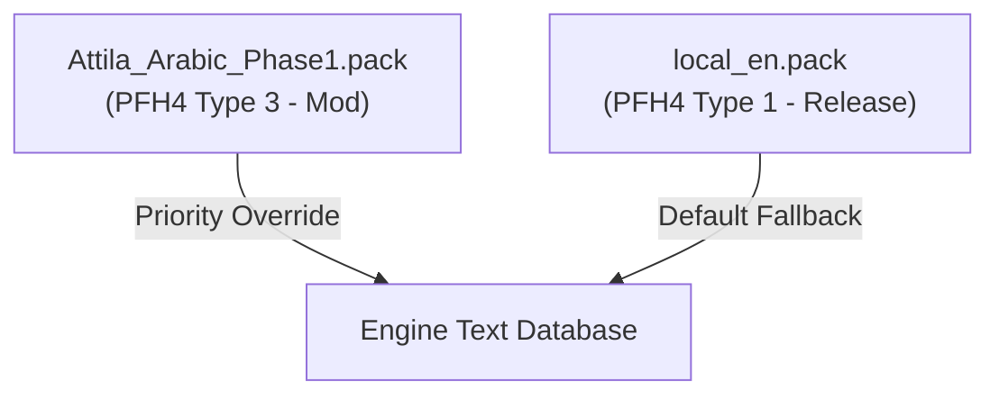
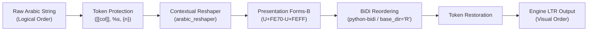

# Total War: ATTILA Localization Architecture Specification

> **Document Classification:** Engine Localization & Translation Pipeline Specification  
> **Target Subsystem:** Warscape Database Localization Subsystem (`text\db\*.loc`)  
> **Status:** FULLY REVERSE-ENGINEERED & VERIFIED BY CODEC

---

## 1. Overview

Text localization in *Total War: ATTILA* is stored in binary string tables with the `.loc` extension inside `data\local_en.pack`. The localization subsystem comprises 174 database tables containing UI text, historical descriptions, unit statistics, advisor dialogue, and event narratives.

---

## 2. Binary `.loc` File Format

The `.loc` format is a straightforward, binary-serialized key-value string dictionary using UTF-16LE encoding:

### 2.1 File Header

```text
Offset    Type        Value / Field
-----------------------------------------
0x00      uint16      0xFEFF (Byte Order Mark, Little-Endian)
0x02      char[4]     "LOC\0" (ASCII identifier)
0x06      int32       1 (Format Version)
0x0A      uint32      entry_count (Number of key-value pairs)
```

### 2.2 Entry Record Structure

Following the 14-byte header, records repeat sequentially for `entry_count` iterations:

| Field Name | Type | Description |
| :--- | :---: | :--- |
| `key_length` | `uint16` | Length of the database key in characters. |
| `key_text` | `UTF-16LE` | Unique localization key string (e.g. `factions_screen_name_...`). |
| `val_length` | `uint16` | Length of the localized text in characters. |
| `val_text` | `UTF-16LE` | Localized string content. |
| `tooltip_flag` | `uint8` | Boolean flag (0 or 1), indicating UI tooltip behavior. |

> [!NOTE]
> The custom codec [`source/loc.py`](file:///d:/AttilaArabic/source/loc.py) achieves **100% byte-identical round-trip verification** across all vanilla tables.

---

## 3. Mod Delivery & Loading Priority



1. **Pack File Header (PFH4)**:
   * Vanilla `local_en.pack` is packed as type `1` (`release`).
   * Our localization pack (`Attila_Arabic_Phase1.pack`) is created as type `3` (`mod`).
2. **Override Mechanism**:
   * Type 3 mod packs take precedence over type 1 release packs when loaded.
   * Full-table copies are shipped to guarantee clean overrides under both file-replacement and key-merging engine modes.

---

## 4. Arabic Shaping & BiDi Pipeline

Because the Warscape text engine renders strictly left-to-right (LTR) with no OpenType shaping support, input text must pass through a multi-stage shaping transformation:



1. **Token Protection**: Preserves formatting tags (such as `[[col:yellow]]...[[/col]]`, `%s`, `%d`, `{0}`) so that syntax markers are not scrambled by bidirectional reordering.
2. **Contextual Reshaping**: Translates logical Arabic letters into their position-specific glyph variants (isolated, initial, medial, or final) in Unicode Presentation Forms-B.
3. **Bidirectional Reordering**: Reverses characters visually so that when the LTR engine renders them left-to-right, they appear in proper right-to-left order on screen.
