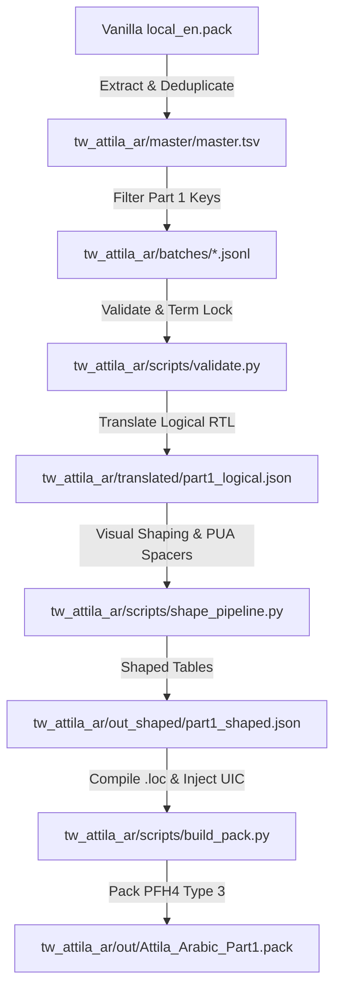

# Total War: Attila - Arabic Localization (Part 1)

Welcome to **Part 1** of the Arabic Localization mod for **Total War: Attila**, delivered as a standalone clean-room override `.pack` (Mod type).

This package covers **everything the player sees prior to entering a campaign**, with a primary focus on the **Faction Selection Screen**, Main Menu, Campaign selection, faction leader details, cultural and faction traits, unit descriptors, and historical lore narratives.

---

## Architecture Overview



---

## Directory Structure

```text
d:/AttilaArabic/tw_attila_ar/
├── AUDIT_EXISTING.md         # Audit of previous modular translation JSON files
├── AUDIT_PROMPT.md           # Phase 0 audit comparing prompt assumptions vs filesystem
├── CLEANUP_PLAN.md           # File inventory and quarantine classification (Gate G1)
├── CLEANUP_REPORT.md         # Verification report and permanent deletion instructions
├── FACTION_SCREEN_MAP.md     # Component layout map & defect diagnostics (Gate G2)
├── FINAL_REPORT.md           # Formal project technical summary & Part 2 roadmap
├── INSTALL.md                # User installation and activation instructions
├── ITERATIONS.md             # In-game screenshot feedback & iteration loop
├── RESTORE.md                # Emergency restoration commands for quarantined items
├── TEST_CHECKLIST.md         # In-game test checklist for all factions and UI elements
├── TOOLING.md                # Reference repo clone notes and schema validation
├── glossary.csv              # Locked terminology table (factions, traits, religions)
├── backup/                   # Pre-cleanup snapshot ZIP and git state
├── batches/                  # 5 validated JSONL batches (459 unique Part 1 keys)
│   ├── progress.json         # Translation progress tracker
│   └── RESUME.md             # Batch resume guide
├── case/                     # Authorized clean-room scope contract
├── master/                   # Vanilla master string database (53,426 keys)
├── out/                      # Build outputs
│   └── Attila_Arabic_Part1.pack  # Compiled standalone mod pack (2.84 MB, PFH4)
├── out_shaped/               # Shaped translations and glyph coverage audit
├── quarantine/               # 94 non-essential items quarantined (~2.1 GB)
├── screenshots/              # Drop folder for in-game visual defect reports
├── scripts/                  # Automated pipeline scripts
│   ├── build_pack.py         # Standalone mod pack compiler & verifier
│   ├── shape_pipeline.py     # BiDi visual shaping and font spacer injection
│   └── validate.py           # Strict batch validator (schema, variables, placeholders)
├── tests/                    # TDD unit test suites
│   ├── test_pack_integrity.py# Pack header, file count, and .loc decoding tests
│   ├── test_shaping.py       # Presentation Forms-B and spacer tests
│   └── test_validate.py      # Batch validation logic tests
├── translated/               # Logical-order Arabic source translation store
└── ui/frontend ui/           # Verified UI layout overrides (Faction screen fixes)
```

---

## Quick Commands

### 1. Run Complete Test Suite
```powershell
& "d:\AttilaArabic\tools\venv\Scripts\python.exe" -m pytest
```
*Executes all 20 unit tests across baseline regression, font continuity, pack integrity, shaping, and validation.*

### 2. Validate Translation Batches
```powershell
& "d:\AttilaArabic\tools\venv\Scripts\python.exe" "d:\AttilaArabic\tw_attila_ar\scripts\validate.py"
```

### 3. Re-Shape Translations
```powershell
& "d:\AttilaArabic\tools\venv\Scripts\python.exe" "d:\AttilaArabic\tw_attila_ar\scripts\shape_pipeline.py"
```

### 4. Build and Verify Standalone Mod Pack
```powershell
& "d:\AttilaArabic\tools\venv\Scripts\python.exe" "d:\AttilaArabic\tw_attila_ar\scripts\build_pack.py"
```
*Compiles all 13 `.loc` tables into binary format, injects the layout overrides, builds the PFH4 mod pack, and re-extracts to perform a 100% round-trip diff verification.*

---

## Key Achievements & Fixes

1. **Standalone Mod Pack (PFH4 Type 3):**
   - Independent 2.84 MB pack that loads seamlessly alongside vanilla game files or other mods without modifying vanilla data.
2. **Fixed Faction Leader & Religion Collision:**
   - Decoupled `tx_faction_leader` and `dy_faction_leader` components in Warscape UIC.
   - Punctuation colon `: ` placed correctly in visual reading order.
   - Religion icon repositioned so it never sits between leader label and name.
3. **Multi-Line Historical Lore Alignment:**
   - Automated injection of PUA blank spacers (`0xE010..0xE015`) to achieve smooth right-aligned parchment text in Warscape UIC textviews.
4. **Clean-Room Strict Separation:**
   - 100% logical Arabic in translation store (`translated/`).
   - Visual shaping (Forms-B, BiDi) isolated entirely to build artifacts (`out_shaped/`, `out/`).
